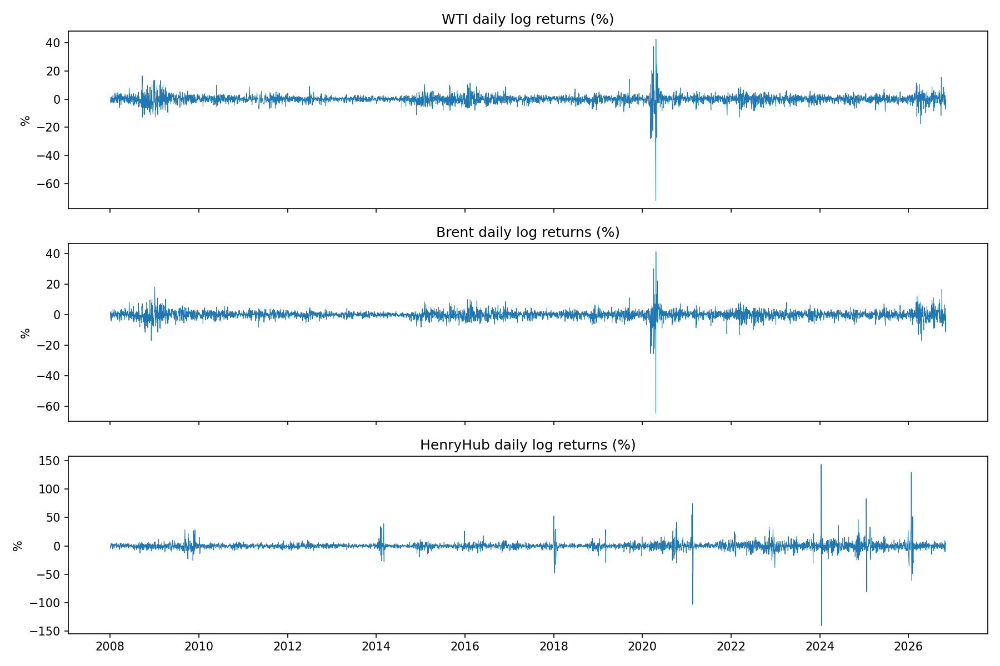
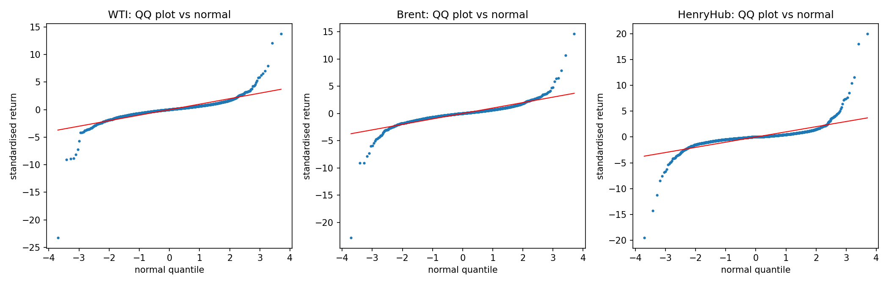
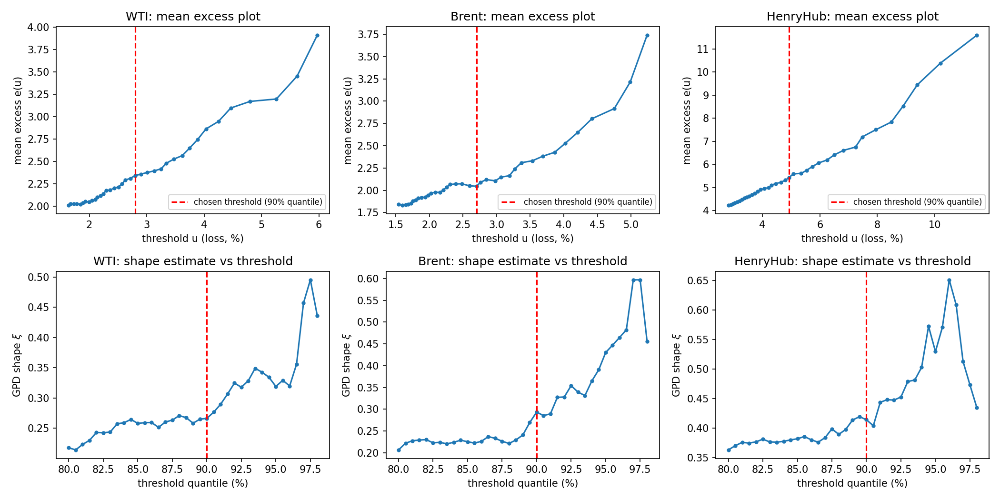
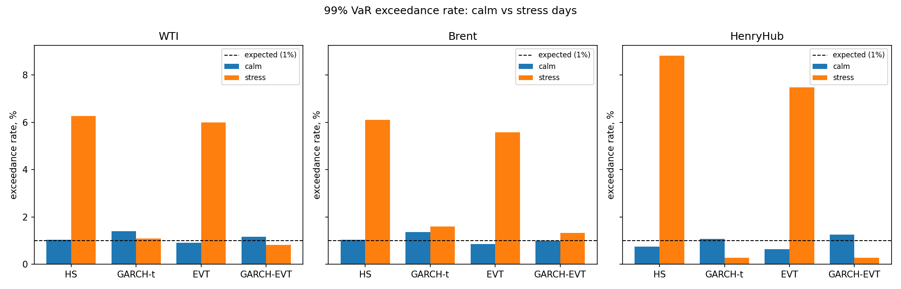
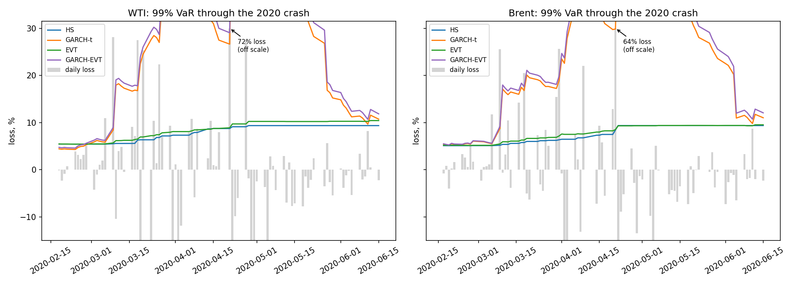
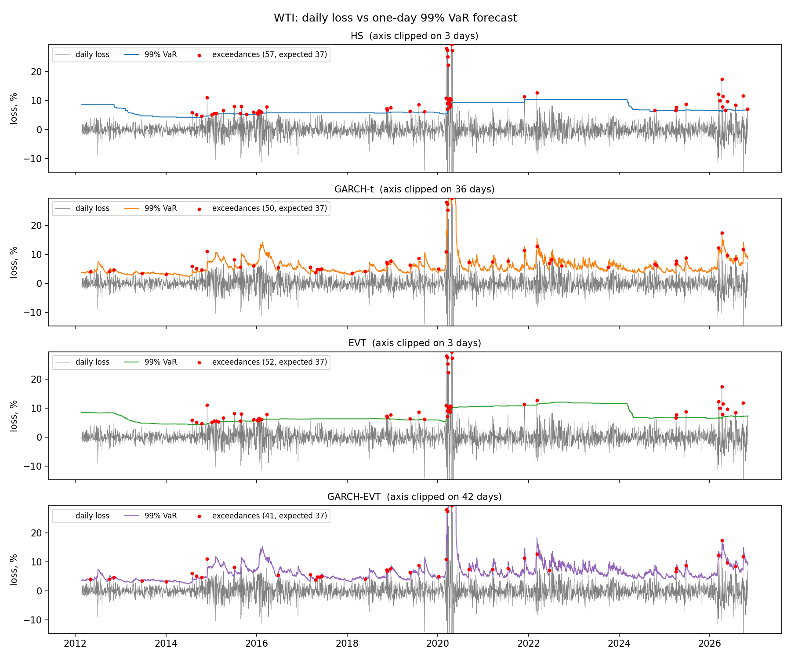
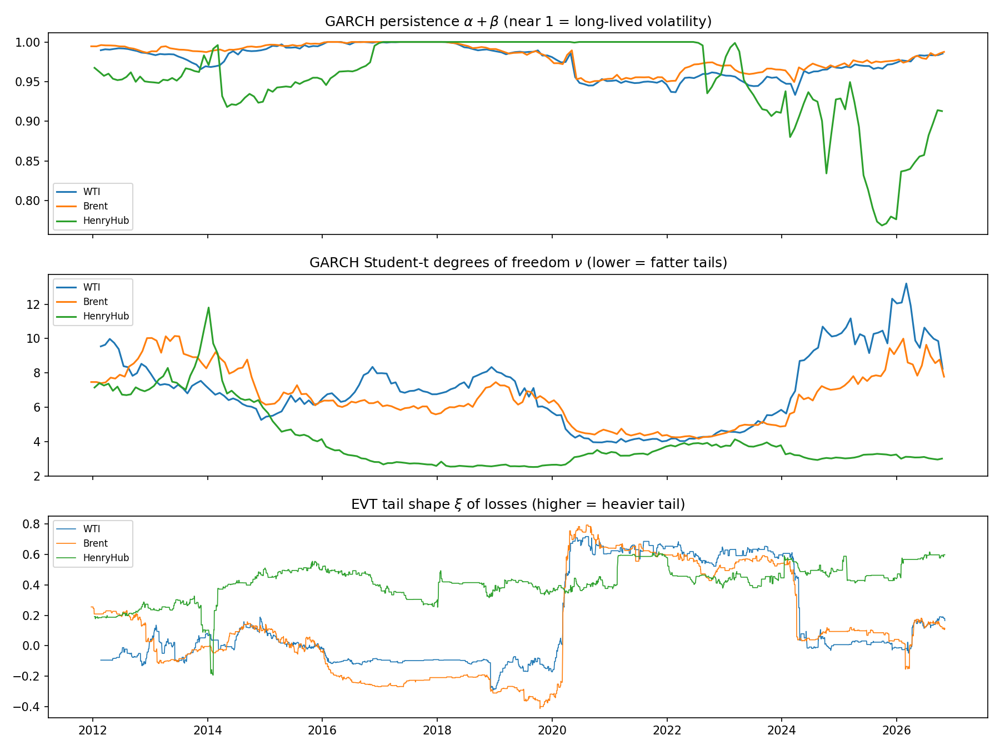

# Oil and Gas Tail Risk: Which VaR Models Survive a Crisis?

Backtesting historical simulation, GARCH and extreme value theory on daily WTI, Brent and Henry Hub returns, 2008–2026.

## Research question

How well do historical simulation, GARCH and extreme value theory estimate Value at Risk (VaR) and Expected Shortfall (ES) for oil and gas returns, and which holds up best in stress periods such as April 2020?

## Summary

The test period covers about 3,700 out-of-sample trading days per commodity, from early 2012 to November 2026. Over that period the most reliable model was **GARCH-EVT**, which filters returns through a GARCH volatility model and then fits an extreme value distribution to the tail of what remains (McNeil & Frey, 2000). It passed 26 of 27 VaR backtests and scored best on average in both calm and stressed markets. **Historical simulation** was the least reliable: on high-volatility days, its 99% VaR was breached 6 to 9 times as often as it should have been.

The central lesson is that **modelling *when* risk changes matters more than modelling the *shape* of the tail**. Extreme value theory on its own barely improved on historical simulation. Both treat every day in a four-year window as equally relevant, so both react slowly when a crisis starts. The same tail model applied on top of a GARCH filter gave the best results of all.

No model was ready for the negative WTI price of April 2020. On the day it entered the data, the best models' 99% VaR was 27–32%, against realised losses of 72% (WTI) and 64% (Brent).

## What we learned

1. **Volatility clustering matters more than tail shape.** The models were compared 27 ways: 3 commodities, 3 confidence levels, and the full, calm and stress samples. In every one of those comparisons, the two GARCH-based models took the top two places by FZ0 score. On high-volatility days, the 99% VaR of historical simulation (HS) and unconditional EVT was breached on 5.6–8.8% of days against a 1% target. The GARCH-based models stayed between 0.3% and 1.6%.

2. **HS and EVT got the number of failures roughly right but the timing wrong.** Over the full sample, HS's 95% VaR for oil was breached on 5.1–5.4% of days, close to the 5% target. But the Christoffersen test rejected independence for both HS and EVT at every confidence level and for every commodity (p ≤ 0.006 in all 18 cases). Their failures arrived in clusters during crises, which is exactly when a risk model matters most.

3. **A better tail model cannot fix a slow window.** Unconditional EVT ranked last on average over the full sample and in calm periods, and third in stress. Its rolling estimate of the tail shape ξ was also unstable. Just before Covid, Brent's estimate fell as low as −0.41, which implies a loss distribution with an upper bound, because the calm window contained no extreme days to learn from. Once 2020 entered the window, the estimate jumped to around 0.7–0.8.

4. **Combining GARCH and EVT works best.** GARCH-EVT passed 26 of 27 Kupiec, Christoffersen and conditional coverage tests. Its only failure was Brent's independence test at 97.5% (p = 0.047). GARCH-t passed 17 of those tests, EVT 5 and HS 3. GARCH-EVT also had the Acerbi–Székely Z2 statistic closest to zero for every commodity, so its ES forecasts were the best calibrated. However, its lead over GARCH-t on the FZ0 score is small and has not been tested for statistical significance.

5. **GARCH-t's weak point is its Student-t assumption.** GARCH-t's VaR for oil was breached more often than targeted at every confidence level: 6.2% at 95%, and 1.36–1.38% at 99%. The excess is statistically significant on calm days rather than in stress. A symmetric Student-t with a single shape parameter cannot match oil's negatively skewed losses. For gas the error runs the other way: Henry Hub's heavy upside spikes fatten the fitted t, so GARCH-t's loss-side ES was about 10% too high (ES ratio 0.90). GARCH-EVT avoids both problems by estimating the loss tail of the GARCH shocks directly from the data.

6. **The best-calibrated model was also the most capital-efficient.** GARCH-EVT's average 99% VaR was lower than both HS and EVT for all three commodities:

   | | GARCH-EVT | HS | EVT |
   |---|---|---|---|
   | WTI | 6.7% | 7.1% | 7.6% |
   | Brent | 6.3% | 6.8% | 6.9% |
   | Henry Hub | 13.6% | 14.2% | 15.0% |

   A model that raises VaR when volatility rises and lowers it when markets calm can be both safer and cheaper than one holding a constant buffer.

7. **Rolling windows create "ghost" effects.** After Covid entered the 1,000-day window in March 2020, the HS and EVT 99% VaR for oil roughly doubled, from about 5–6% to 9–12%. It stayed there for four years, then dropped sharply in early 2024 when the crisis fell out of the window. That drop was caused by the calendar, not the market. HS also "passed" the 2022 energy shock, with one 99% breach against 0.9 expected, but largely because Covid was still inside its window: the right answer for the wrong reason.

8. **No model was ready for April 2020.** The WTI return from 17 to 21 April spans the −\$36.98 settlement on 20 April. GARCH-t and GARCH-EVT forecast a 99% VaR of 27–32% for that day, three to four times the 8.4–8.9% from HS and EVT. The realised losses were 72% (WTI) and 64% (Brent). Over March–May 2020, the GARCH models were breached 4–5 times and HS and EVT 13–15 times, against about 0.6 expected. A futures-expiry and storage squeeze is a structural event that no model fitted to past returns can anticipate, which is why VaR needs stress testing alongside it.

9. **Gas needs a different model.** Henry Hub's winter price spikes reverse within days, but GARCH treats them as persistent. Its estimated persistence α + β sits at the boundary value of 1 in the full sample and for long stretches of the rolling fits. After each spike, GARCH VaR jumps above 60% and stays high for weeks. That made the GARCH models very conservative on stressed gas days, with 0.27% breaches against a 1% target. This is safe but expensive. A jump or regime-switching model would describe spike-and-revert behaviour better.

## Data

Daily spot prices come from [FRED](https://fred.stlouisfed.org) and were originally published by the US Energy Information Administration (EIA).

| Series | FRED code | Units | Raw history |
|---|---|---|---|
| WTI crude oil (Cushing, Oklahoma) | [DCOILWTICO](https://fred.stlouisfed.org/series/DCOILWTICO) | \$ per barrel | 1986–2026 |
| Brent crude oil (Europe) | [DCOILBRENTEU](https://fred.stlouisfed.org/series/DCOILBRENTEU) | \$ per barrel | 1987–2026 |
| Henry Hub natural gas | [DHHNGSP](https://fred.stlouisfed.org/series/DHHNGSP) | \$ per MMBtu | 1997–2026 |

The results below use data downloaded in November 2026, running to 3 November 2026. Downloading again will extend the sample and change the numbers slightly.

### Cleaning decisions

- **The sample starts on 1 January 2008.** Before then, all three series have irregular gaps beyond market holidays: Henry Hub is missing around 200 days a year in 2005–06, and WTI is missing 122 days in 2003. From 2008, missing days fall to the level holidays explain. The one exception is about 40 scattered WTI days in March–July 2011, which are kept.
- **Missing days are dropped, not filled.** Forward-filling creates artificial zero returns, and interpolation invents a price path that never traded. Both understate volatility, which is the worst direction for a risk model to be wrong in.
- **The negative WTI price is treated as a missing day.** A log return is undefined at −\$36.98 (20 April 2020), so that day is dropped and the next return spans 17–21 April (−72.0%). This keeps the size of the shock in the data rather than deleting the stress event, and the return is flagged.
- **Returns are daily log returns in percent.** A loss is a negative return, so the analysis is from the point of view of a long position. Each series keeps its own trading calendar, because Brent follows UK holidays and every model is univariate.

This leaves 4,671 daily returns for WTI, 4,764 for Brent and 4,733 for Henry Hub.

### What the data look like



| | WTI | Brent | Henry Hub |
|---|---|---|---|
| Daily volatility (%) | 3.09 | 2.82 | 7.18 |
| Skewness | −2.09 | −1.99 | +1.16 |
| Excess kurtosis | 83.9 | 76.4 | 113.1 |
| Jarque–Bera p-value | < 0.001 | < 0.001 | < 0.001 |
| Ljung–Box p-value, squared returns (10 lags) | < 0.001 | < 0.001 | < 0.001 |
| GARCH persistence α + β | 0.988 | 0.995 | 1.000 |
| Half-life of a volatility shock (days) | 59 | 129 | infinite |
| Student-t degrees of freedom ν | 6.4 | 6.0 | 3.7 |
| GPD tail shape ξ of losses (largest 10%) | 0.27 | 0.29 | 0.41 |
| Implied tail index 1/ξ | 3.8 | 3.4 | 2.4 |

Four features of the data drive the model choices:

- **The tails are very fat.** Excess kurtosis is far above the normal distribution's value of 0, and the QQ plots bend sharply away from the line at both ends. A tail index below 4 suggests the fourth moment may not even exist, so the kurtosis figures are dominated by a handful of days. They should be read as "very large" rather than as precise estimates. Henry Hub's tail index of 2.4 is not far above 2, the point at which even the variance would be infinite.
- **The tails are asymmetric.** Oil's loss tail is the heavier one (negative skew). For gas it is the gain tail, because of winter price spikes (positive skew).
- **Volatility clusters.** The Ljung–Box test on squared returns rejects strongly, and GARCH persistence is close to 1, so calm and turbulent periods each tend to last. Henry Hub's estimate sits at the boundary of 1, which means shocks never decay in the fitted model.
- **Heavy tails remain after removing clustering.** The GPD shape ξ fitted to the GARCH residuals is about 0.12 for both oil series, against 0.27–0.29 for raw losses. Much of the raw tail heaviness comes from mixing calm and turbulent periods, but not all of it. That is the case for GARCH-EVT.



## Method

### Models

All four models forecast the next day's loss distribution from the previous 1,000 trading days, which is about four years.

| Model | VaR forecast | Reacts to changing volatility? | Tail model |
|---|---|---|---|
| Historical simulation (HS) | Empirical quantile of the last 1,000 losses | No: every day is weighted equally | Empirical |
| GARCH-t | GARCH(1,1) volatility forecast × Student-t quantile | Yes | Symmetric Student-t |
| EVT (peaks over threshold) | Generalised Pareto distribution (GPD) fitted to the largest 10% of losses | No | GPD |
| GARCH-EVT (McNeil & Frey, 2000) | GARCH(1,1) volatility forecast × GPD quantile of the standardised residuals | Yes | GPD fitted to the GARCH shocks |

GARCH-EVT was added to the three methods in the research question because it is their natural combination: GARCH captures *when* risk is high, and EVT captures the *shape* of extreme losses.

**GARCH(1,1)** has a constant mean and Student-t shocks scaled to unit variance:

$$r_t = \mu + \sigma_t z_t, \qquad \sigma_t^2 = \omega + \alpha (r_{t-1} - \mu)^2 + \beta \sigma_{t-1}^2$$

**Peaks over threshold** assumes that losses above a threshold $u$ follow a GPD with shape $\xi$ and scale $s$. With $n$ observations and $N_u$ of them above $u$:

$$\text{VaR}_q = u + \frac{s}{\xi}\left[\left(\frac{n}{N_u}(1-q)\right)^{-\xi} - 1\right], \qquad \text{ES}_q = \frac{\text{VaR}_q + s - \xi u}{1 - \xi}$$

**GARCH-EVT** applies the same formulas to the standardised residuals $z$ and then rescales by the volatility forecast: $\text{VaR}_{t+1} = -\mu + \sigma_{t+1}\,\text{VaR}_q(-z)$, and likewise for ES.

### Backtest design

- **Out-of-sample, one day ahead.** Each forecast uses only data up to the previous day.
- **Re-estimation.** HS and EVT are re-estimated every day. GARCH parameters are re-estimated every 20 trading days (about monthly), while the conditional variance updates daily, so forecasts still react to shocks immediately. All 560 GARCH fits converged.
- **Confidence levels.** The models are tested at 95%, 97.5% (the Basel FRTB level for ES) and 99% (the Basel level for VaR backtesting).
- **EVT threshold.** The threshold is the 90th percentile of losses, which leaves about 100 points per window to fit the tail. The mean excess plots are roughly linear above it, as a GPD tail implies. The shape estimate is stable between about the 82nd and 90th percentiles, and above 90% it rises and becomes noisy as the data thin out. So the chosen threshold sits at the upper end of the stable region.



### Tests and scores

| Measure | Question it answers | Good result |
|---|---|---|
| Kupiec proportion of failures | Is the breach rate right? | p > 0.05 |
| Christoffersen independence | Are breaches independent, or do they cluster? | p > 0.05 |
| Conditional coverage | Both of the above at once | p > 0.05 |
| Acerbi–Székely Z2 | Are losses beyond VaR as large as the ES forecast? | Near 0; below −0.70 rejects at about the 5% level (97.5% ES) |
| ES ratio | Mean loss on breach days ÷ mean forecast ES on those days | 1 |
| FZ0 score (Patton, Ziegel & Chen, 2019) | How accurate are the VaR and ES forecasts jointly? | Lower is better |

VaR tests only check how often losses exceed VaR, not how large those losses are, which is why ES gets its own checks. Backtests also have little power in short windows: a three-month crisis expects less than one breach at 99%. So the models are also ranked with the FZ0 score, a consistent scoring function for VaR and ES forecasts made together. For a loss $L$, VaR forecast $v$ and ES forecast $e$:

$$S(L, v, e) = \frac{\mathbf{1}\{L > v\}\,(L - v)}{(1-q)\,e} + \frac{v}{e} + \ln e - 1$$

### Calm and stress periods

A day counts as stress if its trailing 21-day volatility is in the top 10% of the backtest period for that commodity. The volatility is measured only up to the day before the forecast. This gives cut-offs of 3.48% daily volatility for WTI, 3.35% for Brent and 9.76% for Henry Hub. Using only past information keeps the tests valid, because selecting days by their own returns would mechanically put large losses in the stress group.

Two named episodes are reported separately: the Covid crash (1 March to 31 May 2020) and the Russia–Ukraine shock (24 February to 30 June 2022).

## Results

### Full sample, 99% VaR

| Commodity | Model | Breaches (expected) | Breach rate | Kupiec p | Christoffersen p | Conditional coverage p | FZ0 | Verdict |
|---|---|---|---|---|---|---|---|---|
| WTI | HS | 57 (36.7) | 1.55% | 0.002 | 0.002 | < 0.001 | 2.699 | Too many, clustered |
| WTI | GARCH-t | 50 (36.7) | 1.36% | 0.037 | 0.187 | 0.047 | 2.170 | Too many |
| WTI | EVT | 52 (36.7) | 1.42% | 0.017 | 0.006 | 0.001 | 2.713 | Too many, clustered |
| WTI | GARCH-EVT | 41 (36.7) | 1.12% | 0.485 | 0.087 | 0.181 | **2.164** | Pass |
| Brent | HS | 58 (37.6) | 1.54% | 0.002 | 0.002 | < 0.001 | 2.595 | Too many, clustered |
| Brent | GARCH-t | 52 (37.6) | 1.38% | 0.026 | 0.750 | 0.080 | **2.048** | Too many |
| Brent | EVT | 50 (37.6) | 1.33% | 0.054 | 0.004 | 0.003 | 2.558 | Clustered |
| Brent | GARCH-EVT | 39 (37.6) | 1.04% | 0.825 | 0.424 | 0.709 | 2.055 | Pass |
| Henry Hub | HS | 58 (37.3) | 1.55% | 0.002 | < 0.001 | < 0.001 | 3.617 | Too many, clustered |
| Henry Hub | GARCH-t | 37 (37.3) | 0.99% | 0.957 | 0.389 | 0.689 | 2.772 | Pass |
| Henry Hub | EVT | 49 (37.3) | 1.31% | 0.067 | < 0.001 | < 0.001 | 3.604 | Clustered |
| Henry Hub | GARCH-EVT | 43 (37.3) | 1.15% | 0.362 | 0.317 | 0.400 | **2.771** | Pass |

Bold marks the best FZ0 score for each commodity. The two GARCH models score almost identically at this level; the clear gap is between them and the two unconditional models.

**Scorecard across all levels.** This counts the Kupiec, Christoffersen and conditional coverage tests passed at the 5% significance level, out of 9 per confidence level (3 tests × 3 commodities):

| Model | 95% | 97.5% | 99% | Total (of 27) |
|---|---|---|---|---|
| GARCH-EVT | 9 | 8 | 9 | **26** |
| GARCH-t | 4 | 7 | 6 | 17 |
| EVT | 2 | 1 | 2 | 5 |
| HS | 2 | 1 | 0 | 3 |

The three tests are related, since conditional coverage combines the other two, so this is a scorecard rather than a formal joint test.

### Expected shortfall at 97.5% (the FRTB level)

| Model | Z2 WTI | Z2 Brent | Z2 Henry Hub | ES ratio WTI | ES ratio Brent | ES ratio Henry Hub |
|---|---|---|---|---|---|---|
| HS | −0.336 | −0.414 | −0.442 | 1.131 | 1.081 | 1.025 |
| GARCH-t | −0.365 | −0.237 | +0.086 | 1.105 | 1.096 | 0.904 |
| EVT | −0.346 | −0.397 | −0.393 | 1.051 | 1.031 | 1.064 |
| GARCH-EVT | **−0.062** | **+0.050** | **−0.023** | 1.092 | 1.113 | 1.015 |

No model's ES is rejected over the full sample, since every Z2 is above −0.70. GARCH-EVT's Z2 is the closest to zero for every commodity. Most ES ratios sit a little above 1, meaning losses beyond VaR were on average a few percent larger than the ES forecast.

### Calm vs stress



99% VaR breach rate (target 1%):

| Model | WTI calm | WTI stress | Brent calm | Brent stress | Henry Hub calm | Henry Hub stress |
|---|---|---|---|---|---|---|
| HS | 1.03% | 6.27% | 1.03% | 6.10% | 0.74% | 8.82% |
| GARCH-t | 1.39% | 1.09% | 1.36% | 1.59% | 1.07% | 0.27% |
| EVT | 0.91% | 6.00% | 0.86% | 5.57% | 0.63% | 7.49% |
| GARCH-EVT | 1.15% | 0.82% | 1.00% | 1.33% | 1.25% | 0.27% |

HS and EVT look fine on calm days and fail badly in stress. The same pattern holds at 95%, where they were breached on 15.3–16.4% of stress days against a 5% target. The GARCH-based models hold their breach rate in both regimes. Even so, losses beyond VaR in stress were larger than any model's ES forecast suggested: GARCH-EVT's stress ES ratio at 99% was 1.11–1.52, though each figure rests on only one to five breaches.

Average FZ0 rank across the three commodities and three confidence levels (1 = best):

| Model | Full sample | Calm | Stress |
|---|---|---|---|
| GARCH-EVT | **1.22** | **1.44** | **1.11** |
| GARCH-t | 1.78 | 1.56 | 1.89 |
| HS | 3.33 | 3.11 | 4.00 |
| EVT | 3.67 | 3.89 | 3.00 |

### The Covid crash (March–May 2020)



| Model | WTI breaches (of 62 days) | Brent breaches (of 61 days) | 99% VaR on 21 April, WTI | 99% VaR on 21 April, Brent |
|---|---|---|---|---|
| HS | 15 | 14 | 8.7% | 8.4% |
| GARCH-t | 5 | 5 | 26.6% | 29.8% |
| EVT | 14 | 13 | 8.9% | 8.5% |
| GARCH-EVT | 4 | 5 | 29.1% | 32.1% |
| Expected | 0.6 | 0.6 | Realised loss: 72.0% | Realised loss: 64.4% |

The GARCH models' 99% VaR rose from about 5% in mid-February to around 18% after the 9 March crash, and above 25% by late March. HS and EVT crept up only from about 5.5% to 9%. The GARCH models' FZ0 score over the window was about 9–10, against 24–26 for HS and EVT. Henry Hub had no breaches under any model in this window, because gas was not the market under stress.

The 2022 Russia–Ukraine window was handled reasonably by every model, with one or two 99% breaches each against about 0.9 expected. The worst day was 9 March 2022, a loss of 13.3% for Brent and 12.8% for WTI.

### VaR through time



The same charts for the other two commodities: [Brent](figures/var99_Brent.png) and [Henry Hub](figures/var99_HenryHub.png).

The GARCH-based VaR tracks volatility day by day. HS and EVT move in slow steps, which shows the ghost effect clearly: their VaR jumps in 2020, holds for four years and drops in early 2024. When oil volatility rose again in 2026, HS and EVT were breached repeatedly, while the GARCH-based VaR rose within days.

### Parameter stability



- **Student-t degrees of freedom.** For oil, ν fell from about 6–8 to about 4 while 2020 was in the window, then rose to 8–13 after it left.
- **EVT tail shape.** The rolling ξ for oil jumps when 2020 enters the window and falls back in 2024.
- **Henry Hub persistence.** It sits at the boundary value of 1 from about 2017 to 2022, then falls below 0.8 for six refits between August and December 2025. This is a sign that GARCH(1,1) does not describe gas dynamics well.

## Limitations

- **Narrow risk measure.** The analysis covers a one-day horizon, one commodity at a time and a long position only. It has no 10-day regulatory horizon and no portfolio effects. It also leaves out short positions: for a gas buyer the risk is an upward spike, which for Henry Hub is the heavier tail.
- **Spot prices.** These are not directly tradable. Spot gas prices before weekends and holidays can cover several delivery days, which exaggerates some daily moves.
- **April 2020.** The negative-price episode is handled by letting the return span the missing day, so the true one-day loss is undefined.
- **Constant mean.** The Ljung–Box test on returns themselves is also significant (p < 0.001), so there is modest linear autocorrelation that the models ignore.
- **Symmetric GARCH(1,1).** There is no leverage effect and no skewed distribution, and Henry Hub's estimate sits at the persistence boundary.
- **Fixed settings.** The 1,000-day window, 20-day refit frequency and 90% EVT threshold were not tested for sensitivity.
- **Limited test power.** Each stress sample has about 370 days, so only about 4 breaches are expected at 99%. Differences in FZ0 score between the two GARCH models were not tested for significance.
- **Approximate Z2 critical value.** The −0.70 cut-off is Acerbi and Székely's approximation and is applied only at the 97.5% level.
- **Stress cut-off chosen in hindsight.** Each day's stress label uses only past data, but the cut-off level itself is computed over the whole backtest period.

## Possible extensions

- **Better GARCH specifications:** skewed-t errors or GJR-GARCH to capture asymmetry, and filtered historical simulation as a further benchmark.
- **Formal score comparisons:** Diebold–Mariano tests on FZ0 score differences.
- **Sensitivity analysis** of the window length, refit frequency and EVT threshold.
- **A jump or regime-switching model for gas**, to capture spike-and-revert behaviour.
- **Short positions and multi-day horizons.**
- **A portfolio of the three commodities** with copula-based dependence.
- **Futures data** instead of spot prices.

## How to reproduce

```bash
pip install -r requirements.txt
```

Download the three FRED series into `data/raw/`, keeping the series code as the file name:

- https://fred.stlouisfed.org/graph/fredgraph.csv?id=DCOILWTICO
- https://fred.stlouisfed.org/graph/fredgraph.csv?id=DCOILBRENTEU
- https://fred.stlouisfed.org/graph/fredgraph.csv?id=DHHNGSP

Then run the scripts in order. The rolling forecasts take about five minutes.

```bash
python 01_inspect_data.py       # inspect the raw downloads
python 02_clean_data.py         # cleaning rules, log returns -> data/processed/
python 03_diagnostics.py        # fat tails, clustering, full-sample fits, threshold plots
python 04_rolling_forecasts.py  # out-of-sample VaR/ES forecasts for all four models
python 05_backtest.py           # tests, calm vs stress, events, rankings -> results/
python 06_plots.py              # result figures -> figures/
```

### Repository structure

```
├── config.py              every modelling setting in one place
├── risk_models.py         HS, GARCH-t, EVT and GARCH-EVT estimators
├── 01_inspect_data.py ... 06_plots.py
├── requirements.txt
├── data/
│   ├── raw/               FRED downloads
│   └── processed/         cleaned returns
├── results/               forecasts, parameters and backtest tables (CSV)
└── figures/               all charts in this README
```

## References

- Acerbi, C. and Székely, B. (2014). Backtesting expected shortfall. *Risk*, December 2014.
- Bollerslev, T. (1986). Generalized autoregressive conditional heteroskedasticity. *Journal of Econometrics*, 31(3), 307–327.
- Christoffersen, P. (1998). Evaluating interval forecasts. *International Economic Review*, 39(4), 841–862.
- Fissler, T. and Ziegel, J. F. (2016). Higher order elicitability and Osband's principle. *Annals of Statistics*, 44(4), 1680–1707.
- Kupiec, P. (1995). Techniques for verifying the accuracy of risk measurement models. *Journal of Derivatives*, 3(2), 73–84.
- McNeil, A. J. and Frey, R. (2000). Estimation of tail-related risk measures for heteroscedastic financial time series: an extreme value approach. *Journal of Empirical Finance*, 7(3–4), 271–300.
- McNeil, A. J., Frey, R. and Embrechts, P. (2015). *Quantitative Risk Management: Concepts, Techniques and Tools*, revised edition. Princeton University Press.
- Patton, A. J., Ziegel, J. F. and Chen, R. (2019). Dynamic semiparametric models for expected shortfall (and value-at-risk). *Journal of Econometrics*, 211(2), 388–413.
- Sheppard, K. *arch*: ARCH models in Python. https://github.com/bashtage/arch

---

Sonny Hope · BSc Mathematics with Economics, London School of Economics
